# 🎓 SekolahApp — Master Project SIMS & PPDB Online Terpadu (Laravel 10 + React 18 + Inertia.js)

<p align="center">
  
  
  
  
  
  
</p>

---

## 📌 Ikhtisar Proyek

**SekolahApp** adalah **Master Project Template / Boilerplate Komersial** Sistem Informasi Manajemen Sekolah (SIMS) berbasis web modern untuk jenjang **SMA, SMK, SMP, SD, maupun Madrasah (MA/MTs)**.

Dirancang khusus dengan arsitektur **White-Label**, memungkinkan Anda atau agensi software house mengkloning dan menyesuaikan identitas sekolah (Nama, Logo, NPSN, Kepala Sekolah, Kalender Akademik, KKM, Alamat, Kontak Dinas) secara instan melalui file `.env` maupun **Dashboard Web Admin (`/admin/settings`)**.

> 🔒 **Catatan Akses Repositori**:
> Repositori ini adalah repositori **Showcase Publik & Dokumentasi Resmi**. Source code master lengkap (beserta seluruh seeder, controller, views, dan automated tests) disimpan di repositori privat komersial dan dapat diperoleh melalui lisensi resmi.
>
> 🛒 **Ingin Mendapatkan Source Code Lengkap?**
> 👉 [Hubungi WhatsApp Resmi](https://wa.me/6281234567890?text=Halo%20saya%20tertarik%20membeli%20Source%20Code%20Master%20SekolahApp) | 📧 [Kirim Email](mailto:developer@sekolahapp.com) | 📄 Lihat [Paket Harga & Lisensi](#-paket-lisensi--harga)

---

## 📸 Tangkapan Layar Sistem (Screenshot Preview)

Berikut adalah preview tampilan antarmuka nyata dari sistem SekolahApp dengan standar desain modern *Corporate Slate*:

### 1. Dashboard Utama Administrator (16 Modul SIMS)
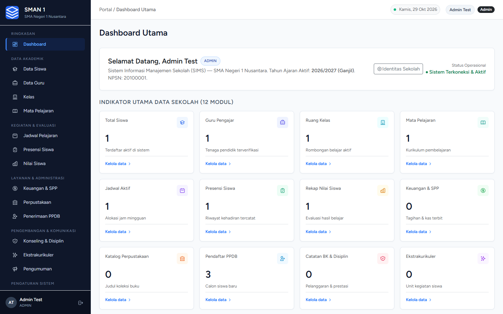

---

### 2. Modul Akademik & Kepegawaian (Data Siswa & Pendidik)
| Data Siswa Terpadu | Data Tenaga Pendidik |
| :---: | :---: |
| 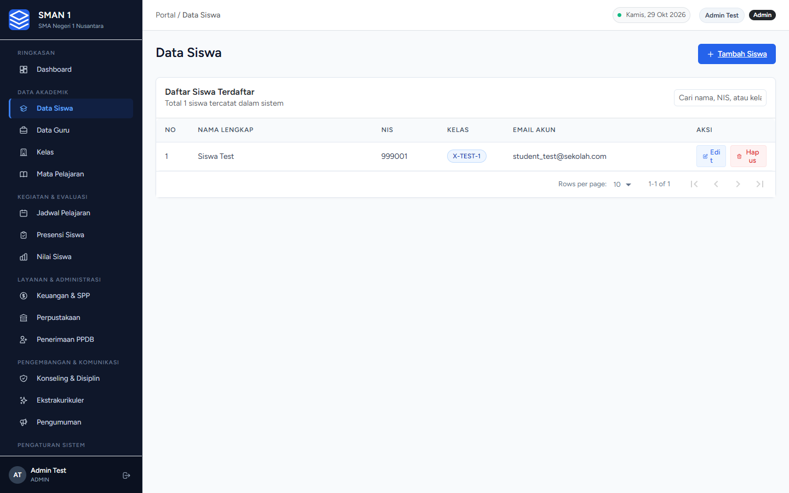 | 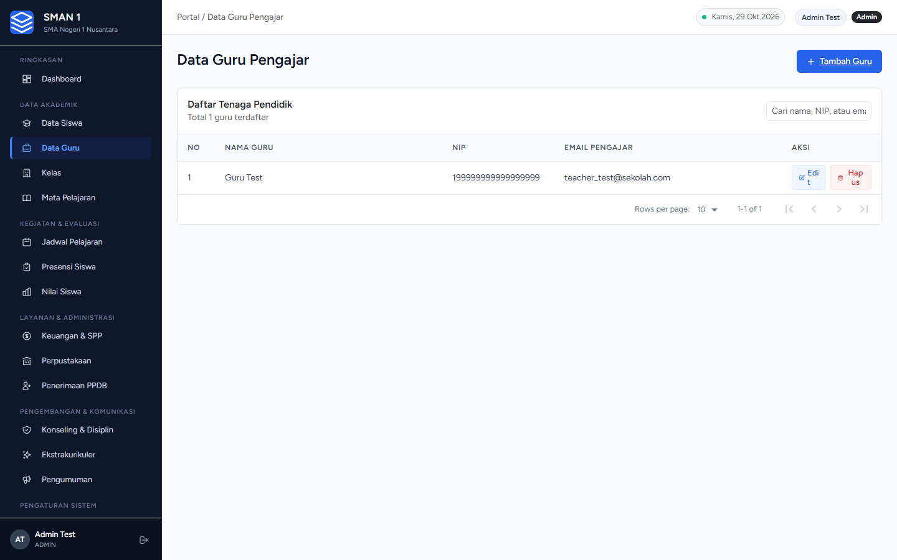 |

---

### 3. Penjadwalan Pelajaran & Keuangan SPP
| Jadwal KBM Mingguan | Manajemen Tagihan & Kas SPP |
| :---: | :---: |
| 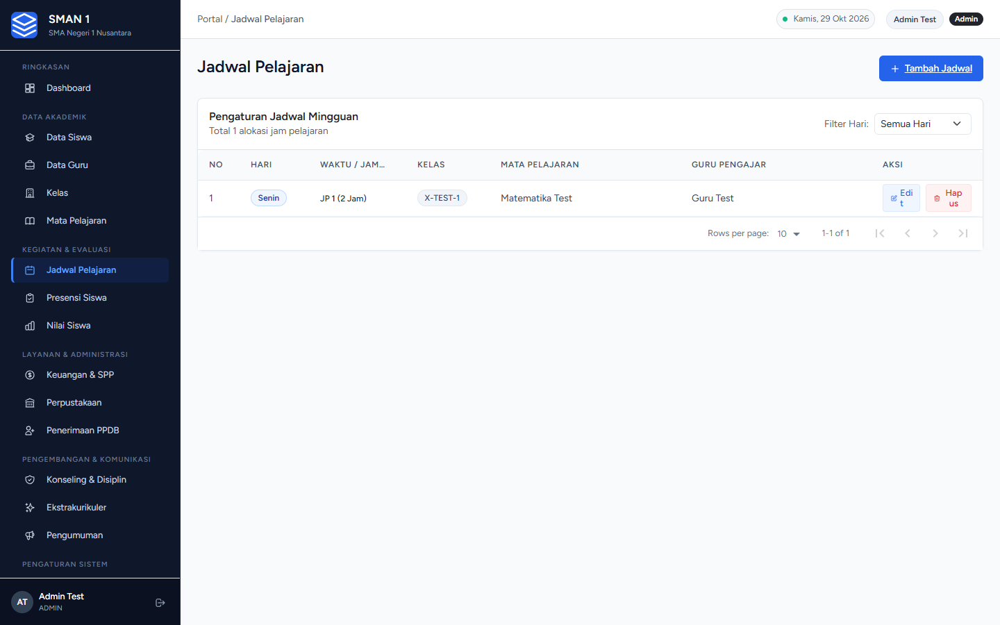 | 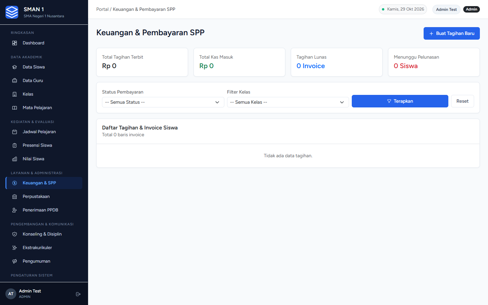 |

---

### 4. Pengaturan Identitas Sekolah Dinamis (White-Label)
Ubah profil sekolah, kepala sekolah, logo, tahun ajaran, dan kuota PPDB secara instan melalui web:
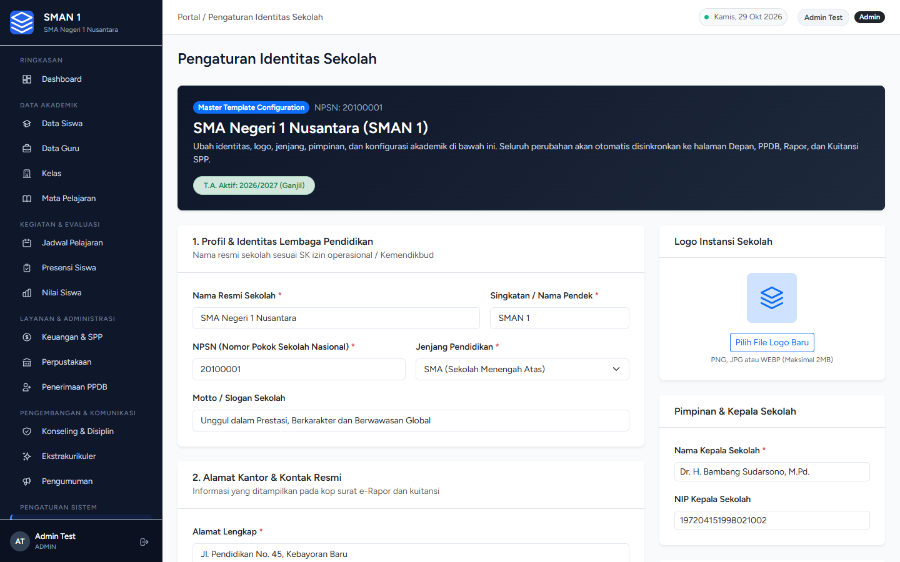

---

### 5. Portal Mandiri Guru Pengajar (`/teacher/*`)
Akses khusus guru untuk jadwal mengajar, presensi siswa rombel, dan input nilai capaian:
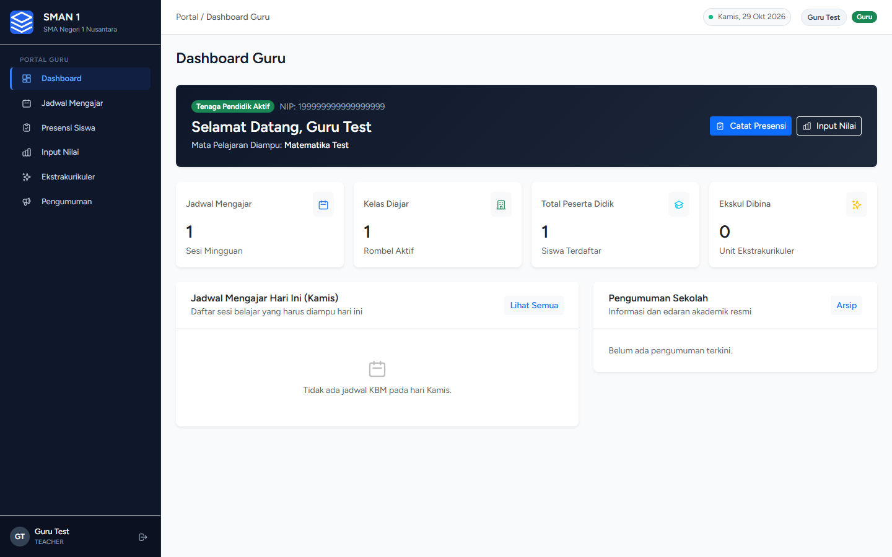

| Lembar Presensi Siswa Cepat | Input Nilai Rapor & Grade Otomatis |
| :---: | :---: |
| 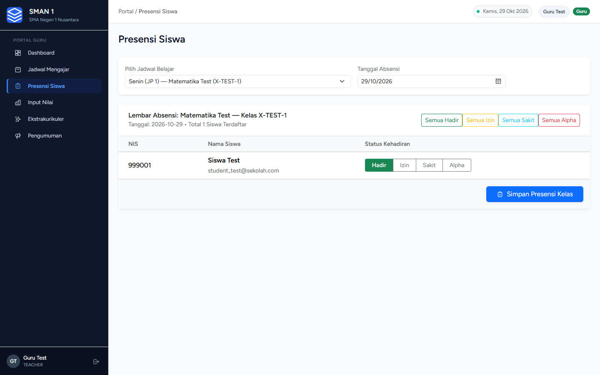 | 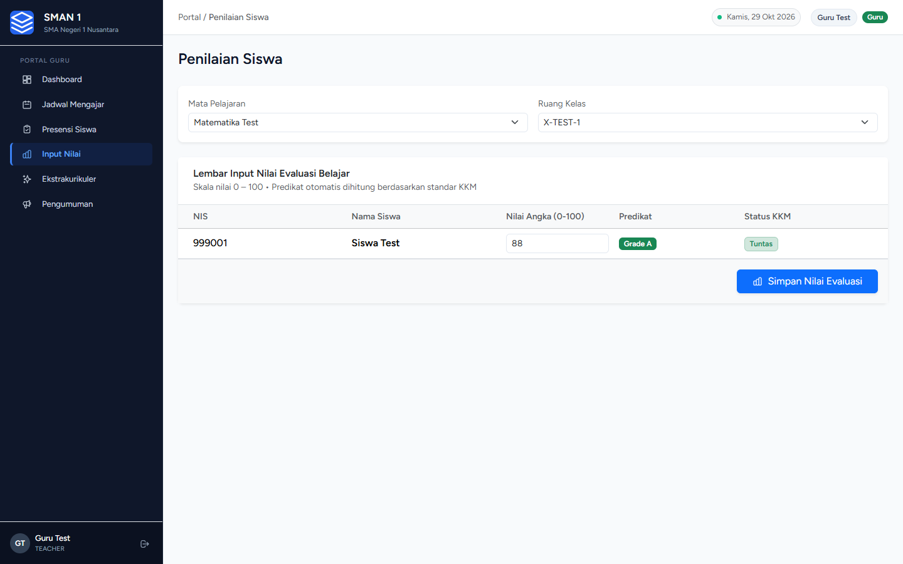 |

---

### 6. Portal Peserta Didik / Siswa (`/student/*`)
Akses mandiri siswa untuk memantau kehadiran belajar, nilai rapor, dan status pembayaran SPP:
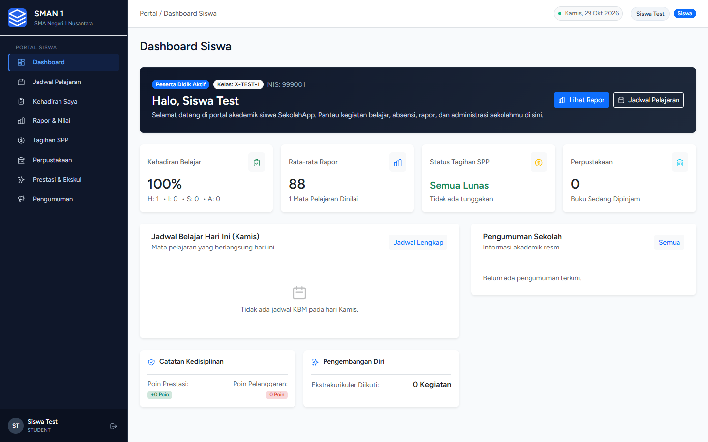

| Lembar Nilai & e-Rapor Cetak | Rekap Tagihan SPP Mandiri |
| :---: | :---: |
| 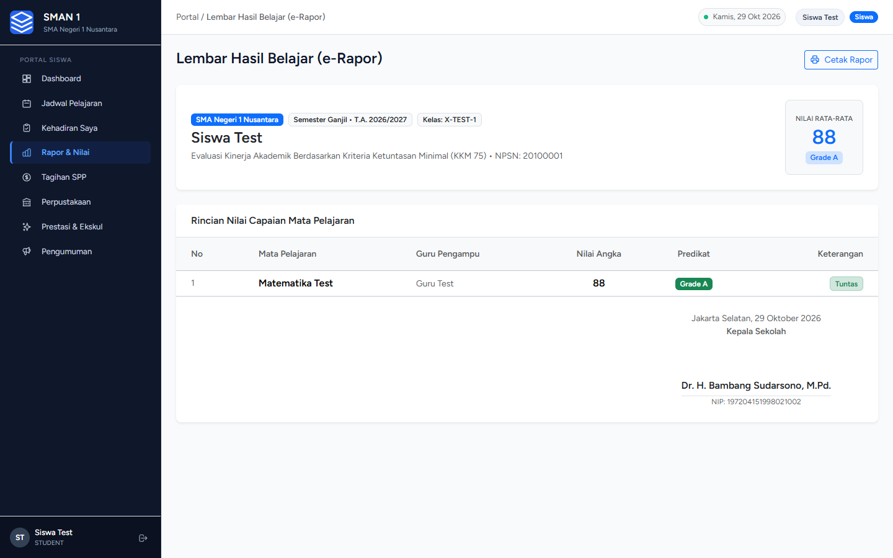 | 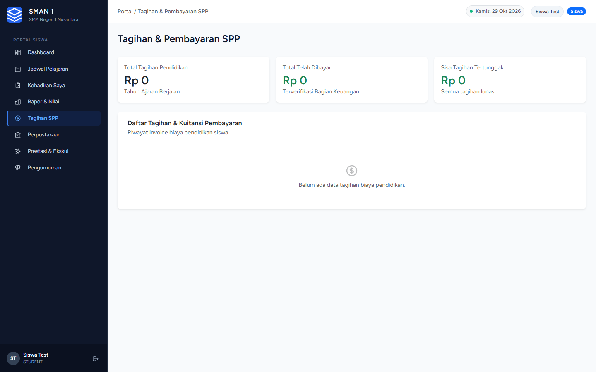 |

---

### 7. Portal Publik Calon Siswa (PPDB Online)
Formulir pendaftaran calon siswa tanpa login dengan penerbitan bukti pendaftaran resmi dan cek status online:
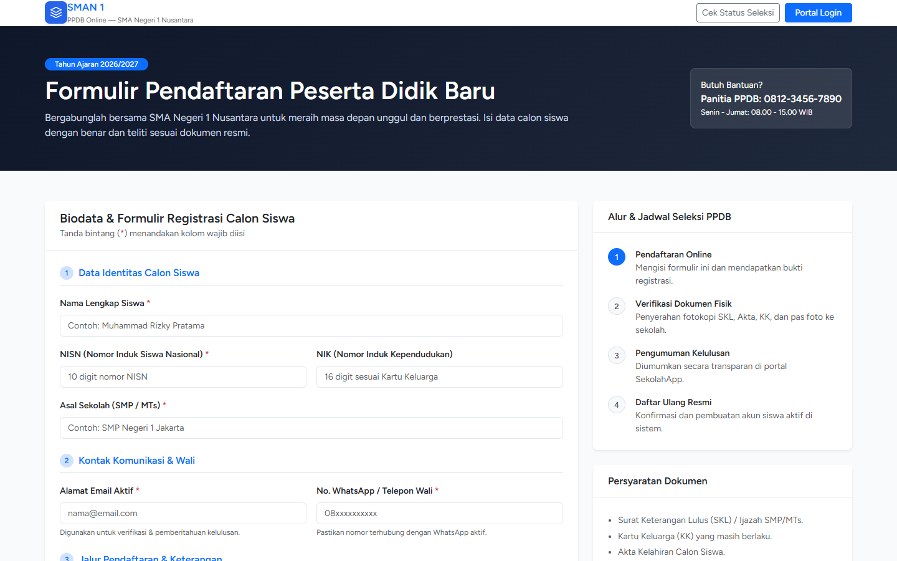

---

### 8. Manajemen Lisensi & Pembatasan Domain Kriptografis (`/license/activate`)
Sistem dilengkapi proteksi aktivasi domain berbasis tanda tangan digital (HMAC SHA-256) untuk mengontrol kuota kloning:
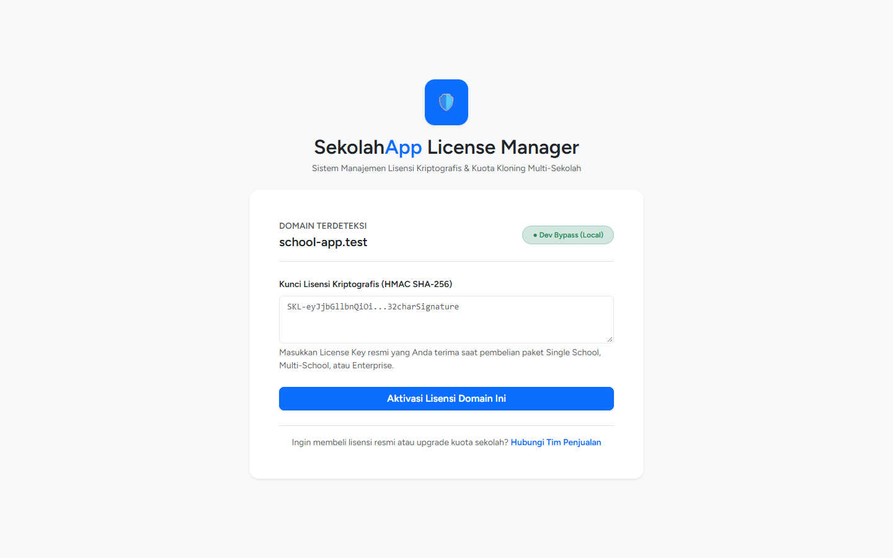

---

## 🌟 4 Portal Pengguna Terintegrasi (Strict Multi-Role RBAC)

Aplikasi ini membagi hak akses ke dalam 4 portal terisolasi:

```
┌─────────────────────────────────────────────────────────────────┐
│                    SEKOLAHAPP ECOSYSTEM                         │
├─────────────────┬─────────────────┬──────────────┬──────────────┤
│  PORTAL ADMIN   │   PORTAL GURU   │ PORTAL SISWA │ PORTAL PPDB  │
│  (16 Modul SIMS)│(KBM, Absen, Nilai│(Rapor, SPP,  │(Pendaftaran &│
│                 │ & Ekskul)       │ Perpustakaan)│ Cek Kelulusan│
└─────────────────┴─────────────────┴──────────────┴──────────────┘
```

1. **Portal Administrator (`/admin/*`)**:
   - Pengelolaan menyeluruh 16 modul: master data siswa/guru/kelas, kurikulum mapel, jadwal pelajaran mingguan, batch attendance, e-Rapor, tagihan SPP, perpustakaan, PPDB online, konseling BK, ekstrakurikuler, pengumuman, dan pengaturan identitas sekolah.
2. **Portal Guru Pengajar (`/teacher/*`)**:
   - Jadwal mengajar harian & mingguan.
   - Lembar presensi siswa per sesi kelas dengan tombol aksi cepat (*Semua Hadir*, *Izin*, *Sakit*, *Alpha*).
   - Input nilai angka (0–100) dengan konversi otomatis ke Predikat (Grade A, B, C, D) & status tuntas KKM.
   - Pengelolaan nilai capaian ekstrakurikuler bagi guru pembina.
   - Papan warta pengumuman dinas sekolah.
3. **Portal Peserta Didik (`/student/*`)**:
   - Jadwal KBM per kelas siswa.
   - Riwayat presensi kehadiran dan persentase kehadiran belajar.
   - Lembar Hasil Belajar (**e-Rapor**) lengkap dengan KKM, predikat, rata-rata nilai, dan tombol **Cetak Rapor**.
   - Monitoring tagihan SPP & uang gedung, riwayat pembayaran, dan sisa tunggakan.
   - Informasi sirkulasi pinjaman buku perpustakaan & katalog buku digital.
   - Buku catatan prestasi & kedisiplinan BK serta kegiatan ekstrakurikuler yang diikuti.
4. **Portal Publik Calon Siswa (PPDB Online) (`/ppdb/daftar`)**:
   - Pendaftaran calon siswa baru secara online tanpa perlu login.
   - Penerbitan otomatis **Kartu Tanda Peserta PPDB** siap cetak dengan nomor registrasi resmi unik (`PPDB-2026-XXXX`).
   - Pelacakan status seleksi berkas & kelulusan secara real-time via NISN/Email di `/ppdb/status`.

---

## 📦 Katalog 16 Modul Sistem Lengkap

| No | Modul | Rute URL | Deskripsi Fitur Unggulan |
| :-: | :--- | :--- | :--- |
| 1 | **Autentikasi & Keamanan (RBAC)** | `/login` | Proteksi middleware role strict (`role:admin`, `role:teacher`, `role:student`), auto-redirect login, pencegahan 403 lintas portal. |
| 2 | **Dashboard Eksekutif** | `/dashboard` | 12 KPI Metric Cards real-time, status operasional, salam personal, dan tombol Quick Action langsung. |
| 3 | **Data Siswa** | `/admin/student` | Biodata peserta didik, validasi NIS unik, rombel kelas, akun login otomatis terintegrasi. |
| 4 | **Data Guru / Pendidik** | `/admin/teacher` | Profil tenaga pendidik, NIP unik, gelar, email dinas, akun login role `teacher`. |
| 5 | **Ruang Kelas (Rombel)** | `/admin/kelas` | Manajemen jenjang rombongan belajar dengan indikator kapasitas siswa terdaftar secara real-time. |
| 6 | **Mata Pelajaran** | `/admin/subject` | Inventaris kurikulum mapel dengan relasi *Many-to-Many* ke guru pengampu via tabel pivot. |
| 7 | **Jadwal Pelajaran** | `/admin/schedule` | Penyusunan jadwal KBM terpadu (Hari, JP Mulai, Durasi JP, Kelas, Mapel, Guru Pengampu). Filter harian. |
| 8 | **Presensi / Absensi Siswa** | `/admin/student_attendance` | Fitur modal **Batch Attendance** satu rombel sekaligus, tombol cepat massal, mekanisme `updateOrCreate`. |
| 9 | **Penilaian & e-Rapor** | `/admin/score` | Input nilai angka evaluasi belajar (0–100), penetapan grade A/B/C/D otomatis, cetak rapor format resmi. |
| 10 | **Keuangan & Pembayaran SPP** | `/admin/finance` | Invoicing tagihan bulanan/uang gedung, pencatatan transaksi tunai/transfer, kuitansi digital, rekap kas. |
| 11 | **Perpustakaan Digital** | `/admin/library` | Inventaris katalog buku (ISBN, rak, stok), sirkulasi peminjaman, batas jatuh tempo, dan denda otomatis. |
| 12 | **PPDB Online Terpadu** | `/admin/ppdb` & `/ppdb/*` | Pendaftaran mandiri calon siswa, pencetakan kartu registrasi, verifikasi berkas, dan pelacakan status. |
| 13 | **Bimbingan Konseling (BK)** | `/admin/counseling` | Rekam poin kedisiplinan (pelanggaran tata tertib) & apresiasi poin prestasi, sesi konseling siswa. |
| 14 | **Ekstrakurikuler** | `/admin/extracurricular` | Pengelolaan klub bakat minat, penunjukan pembina, pendaftaran anggota, penilaian predikat rapor. |
| 15 | **Papan Pengumuman** | `/admin/announcements` | Penerbitan warta edaran resmi dengan filter target audiens (*Semua Warga*, *Guru*, *Siswa*). |
| 16 | **Identitas Sekolah (Master Settings)** | `/admin/settings` | Pengaturan profil sekolah, logo, NPSN, pimpinan, kalender akademik, switch buka/tutup PPDB. |

---

## 🎨 Standar Desain Antarmuka: Modern Corporate UI

- **Color Palette**: Deep Slate Navy (`#0f172a`), Clean Surface White (`#ffffff`), Slate Border (`#e2e8f0`), Primary Blue (`#2563eb`).
- **Typography & Icons**: Inter Font, Line Vector Icons SVG presisi (bebas dari emoji kekanak-kanakan atau warna neon mencolok).
- **Responsive Standard**: Sempurna dibuka di Desktop Monitor, Tablet/iPad, maupun Smartphone Android/iOS.
- **Ready for Print**: Lembar e-Rapor dan Kartu PPDB didesain dengan format khusus CSS `@media print` sehingga rapi saat dicetak ke PDF atau kertas fisik.

---

## 🏗️ Tech Stack & Arsitektur

```
┌────────────────────────────────────────────────────────┐
│                   SEKOLAHAPP STACK                     │
├────────────────────────────────────────────────────────┤
│ Backend   : Laravel 10 (PHP 8.2+)                      │
│ Frontend  : React 18, JSX, Tailwind CSS, Bootstrap 5   │
│ Adapter   : Inertia.js v1 (SPA Monolith)               │
│ Build Tool: Vite 5 (Hot Module Replacement)            │
│ Database  : MySQL 8.x / MariaDB (19 Relational Tables) │
│ Tests     : PHPUnit Feature & Unit Tests (57 Passed)   │
└────────────────────────────────────────────────────────┘
```

---

## 🛡️ Sistem Manajemen Lisensi & Hak Kloning (HMAC SHA-256)

Aplikasi master project ini telah dilengkapi dengan arsitektur **Cryptographic License Manager (`App\Services\LicenseService`)**:
1. **Pencegahan Kloning Tanpa Izin**: Setiap kunci lisensi (`SKL-...`) ditandatangani secara kriptografis menggunakan algoritma **HMAC SHA-256**. Manipulasi payload (seperti mengubah batas domain atau tier secara sepihak) otomatis merusak tanda tangan digital.
2. **Pembatasan Kuota Domain (Domain Quota Enforcement)**:
   - **Single School**: Otomatis mengunci (*bind*) pada 1 nama domain aktif.
   - **Multi-School (Agensi)**: Mengizinkan aktivasi otomatis hingga kuota **5 domain sekolah**. Upaya instalasi pada domain ke-6 akan otomatis dialihkan ke layar aktivasi `/license/activate` dan menolak akses operasional sebelum lisensi di-upgrade.
   - **Enterprise White-Label**: Unlimited domain tanpa batasan kuota.
3. **CLI Generator untuk Developer / Pemilik**:
   ```bash
   # Generate key untuk pembeli Single School:
   php artisan license:generate --client="SMAN 1 Nusantara" --tier=single

   # Generate key untuk pembeli Multi-School (5 Sekolah):
   php artisan license:generate --client="Yayasan Pendidikan Bersama" --tier=multi_school --max-domains=5

   # Cek status lisensi instalasi:
   php artisan license:status
   ```
4. **Bypass Lingkungan Pengembangan**: Domain lokal (`localhost`, `127.0.0.1`, `school-app.test`) otomatis dibebaskan dari kewajiban aktivasi agar tidak mengganggu proses coding dan testing lokal Anda.

---

## 💰 Paket Lisensi & Harga

Kami menyediakan pilihan lisensi yang fleksibel sesuai kebutuhan Anda:

| Fitur / Hak Penggunaan | Lisensi Single School | Lisensi Multi-School (Agensi) | Full Master White-Label |
| :--- | :---: | :---: | :---: |
| **Jumlah Sekolah** | 1 Instansi Sekolah | Hingga 5 Sekolah | **Unlimited Sekolah** |
| **Akses Source Code Lengkap** | ✅ Full Source Code | ✅ Full Source Code | ✅ Full Master Project |
| **16 Modul SIMS Lengkap** | ✅ Ya | ✅ Ya | ✅ Ya |
| **Portal Guru & Siswa** | ✅ Ya | ✅ Ya | ✅ Ya |
| **PPDB Online Mandiri** | ✅ Ya | ✅ Ya | ✅ Ya |
| **Hak Re-Branding Logo & Nama** | ✅ Bebas | ✅ Bebas | ✅ **Bebas Tanpa Batas** |
| **Automated Tests Suite (51 Tests)** | ✅ Disertakan | ✅ Disertakan | ✅ Disertakan |
| **Dukungan Bantuan Instalasi** | 1 Bulan | 3 Bulan | **6 Bulan Prioritas** |
| **Investasi** | **Rp 1.500.000** | **Rp 3.500.000** | **Hubungi Kami** |

---

## 📞 Cara Pemesanan & Pembelian Source Code

Untuk mendapatkan akses repositori privat atau paket instalasi instan:

1. **Hubungi WhatsApp**: Klik tautan langsung 👉 **[Chat WhatsApp: 0812-3456-7890](https://wa.me/6281234567890?text=Halo%20Admin%2C%20saya%20ingin%20membeli%20Source%20Code%20Master%20SekolahApp)**
2. **Email Bisnis**: Kirim penawaran ke **`developer@sekolahapp.com`**
3. **Metode Pembayaran**: Mendukung QRIS, Transfer Bank (BCA, Mandiri, BNI, BRI), Virtual Account, dan Kartu Kredit.
4. **Pengiriman**: Setelah konfirmasi pembayaran, akun GitHub Anda akan langsung diundang (*invite collaborator*) ke private repository master, atau dikirimi link unduhan paket arsip ZIP lengkap beserta panduan instalasi langkah-demi-langkah.

---

## ❓ FAQ (Pertanyaan yang Sering Diajukan)

<details>
<summary><b>1. Apakah source code 100% bebas diubah?</b></summary>
Ya. Setelah membeli lisensi, Anda mendapatkan source code lengkap tanpa enkripsi (tidak di-obfuscate), sehingga Anda dapat bebas mengubah fitur, warna tema, maupun menambahkan modul baru.
</details>

<details>
<summary><b>2. Apakah cocok untuk proyek software house / agensi IT?</b></summary>
Sangat cocok! Proyek ini memang dibangun sebagai <i>Master Boilerplate</i>. Anda bisa menjual kembali layanan instalasi aplikasi SIMS ini ke sekolah-sekolah lain dengan nama brand Anda sendiri menggunakan Lisensi Multi-School atau White-Label.
</details>

<details>
<summary><b>3. Bagaimana cara melakukan kustomisasi identitas sekolah baru?</b></summary>
Sangat mudah. Anda hanya perlu mengisi file <code>.env</code> atau masuk ke menu <b>Portal Admin > Pengaturan Sistem > Identitas Sekolah</b> untuk mengganti nama sekolah, NPSN, logo, alamat, dan kepala sekolah. Semua halaman otomatis terupdate!
</details>

<details>
<summary><b>4. Apa persyaratan server untuk menjalankan aplikasi ini?</b></summary>
Aplikasi dapat dijalankan di Shared Hosting (cPanel / DirectAdmin), VPS (Ubuntu / Debian / Nginx / Apache), maupun server lokal seperti Laragon / XAMPP dengan PHP 8.1 / 8.2+ dan MySQL 8.x.
</details>

---

<p align="center">
  <b>SekolahApp Enterprise</b> — Solusi Digitalisasi Sekolah Indonesia Modern.<br>
  © 2026 Hak Cipta Dilindungi Undang-Undang.
</p>
