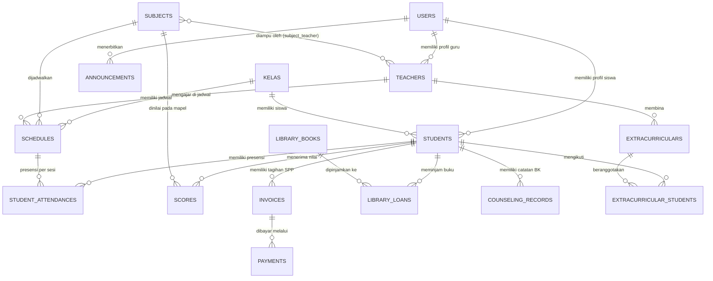

# Ringkasan Fitur & Dokumentasi Sistem — SekolahApp (Versi 2.0 - Diperbarui)

Dokumentasi lengkap arsitektur sistem, modul fungsional (termasuk modul penunjang operasional sekolah modern), struktur data/ERD relasional, dan panduan penggunaan aplikasi **SekolahApp** (Sistem Informasi Manajemen Sekolah Terpadu).

---

## 1. Ikhtisar Aplikasi

**SekolahApp** adalah platform aplikasi berbasis web modern untuk mengelola seluruh administrasi akademik dan operasional sekolah secara terpusat. Lingkup pengelolaan mencakup data master peserta didik dan tenaga pendidik, alokasi ruang kelas/rombel, penugasan mata pelajaran, penyusunan jadwal mingguan, rekapitulasi presensi harian, penilaian hasil belajar (e-Rapor), hingga manajemen keuangan SPP, perpustakaan digital, PPDB online, bimbingan konseling (BK) & kedisiplinan, ekstrakurikuler, dan papan pengumuman digital.

Aplikasi dirancang dengan standar **Modern Corporate / Enterprise UI** bernuansa *Slate Navy* (`#0f172a`), tata letak profesional, tipografi terstruktur, dan ikon vektor garis (line icons) minimalis tanpa emoji berlebihan.

---

## 2. Tech Stack & Arsitektur

| Komponen | Teknologi | Deskripsi |
| :--- | :--- | :--- |
| **Backend Framework** | Laravel 10 (PHP 8.2+) | Arsitektur MVC terisolasi, Service Layer, Form Request Validation, dan Database Transactions. |
| **Frontend Adapter** | Inertia.js v1 | Monolith modern tanpa perlu REST API terpisah, rendering komponen React langsung dari routing Laravel. |
| **Frontend UI** | React 18 & JSX | Komponen modular reaktif, stateful modals, dan visualisasi data. |
| **Build Tool** | Vite 5 | Kompilasi aset frontend ultra-cepat dan Hot Module Replacement (HMR). |
| **Styling & Theme** | Bootstrap 5 + Tailwind CSS | Tata letak responsif, sistem grid fleksibel, dan kustomisasi variabel Corporate Slate. |
| **Database** | MySQL / MariaDB | Relasional dengan foreign key constraints, cascading delete, dan indexing performa tinggi. |
| **Datatable** | React Data Table Component | Tabel interaktif dilengkapi pagination, sorting kolom dinamis, dan pencarian instan. |
| **Notifikasi** | React Toastify | Alert toast interaktif dan modal konfirmasi aksi (*Confirm Toast*). |

---

## 3. Modul & Fitur Lengkap Sistem (16 Modul)

### 3.1. Autentikasi & Keamanan (Role-Based Access Control)
- **Otorisasi Multi-Portal Terpisah**:
  - **Portal Administrator (`/admin/*`)**: Terproteksi ketat dengan middleware `['auth', 'role:admin']`. Mengelola seluruh modul sistem secara global.
  - **Portal Guru (`/teacher/*`)**: Terproteksi ketat dengan middleware `['auth', 'role:teacher']`. Hanya dapat diakses oleh akun guru pengajar untuk mengelola jadwal mengajar, presensi kelas, input nilai, pembinaan ekskul, dan informasi pengumuman.
  - **Portal Siswa (`/student/*`)**: Terproteksi ketat dengan middleware `['auth', 'role:student']`. Khusus untuk peserta didik dalam memantau jadwal KBM, kehadiran pribadi, rapor hasil belajar, status tagihan SPP, peminjaman buku perpustakaan, catatan kedisiplinan/prestasi, serta pengumuman sekolah.
- **Smart Role Redirect**: Endpoint login default (`/dashboard`) secara otomatis mengarahkan pengguna sesuai hak aksesnya (`teacher` ke `/teacher/dashboard`, `student` ke `/student/dashboard`, `admin` ke `/admin/dashboard`). Percobaan akses silang portal akan menghasilkan `403 Forbidden`.
- **Manajemen Akun Terpadu**: Penambahan data Siswa atau Guru baru secara otomatis menginisialisasi akun login di tabel `users` dengan enkripsi kata sandi `bcrypt`.
- **Manajemen Profil Mandiri**: Pengguna dapat memperbarui nama, email login, serta kata sandi akun secara mandiri melalui modul profil.

### 3.2. Dashboard Eksekutif (Corporate Overview)
- **Banner Status Operasional**: Menyajikan status sistem aktif, salam personal pengguna, dan role yang sedang aktif.
- **Indikator Metrik Utama (12 KPI Cards)**:
  1. *Total Siswa*: Jumlah peserta didik aktif.
  2. *Total Guru*: Jumlah tenaga pendidik terverifikasi.
  3. *Total Kelas*: Jumlah rombongan belajar aktif.
  4. *Total Mata Pelajaran*: Jumlah kurikulum mapel.
  5. *Jadwal Aktif*: Jumlah alokasi sesi mengajar mingguan.
  6. *Presensi Terekam*: Akumulasi kehadiran siswa.
  7. *Rekap Nilai*: Total nilai evaluasi belajar yang telah diinput.
  8. *Penerimaan SPP*: Total kas pembayaran SPP/biaya pendidikan yang berhasil dihimpun.
  9. *Peminjaman Buku*: Jumlah sirkulasi buku perpustakaan yang sedang dipinjam.
  10. *Pendaftar PPDB*: Jumlah calon siswa baru yang terdaftar di sistem.
  11. *Catatan BK*: Akumulasi kasus pelanggaran maupun prestasi siswa.
  12. *Ekstrakurikuler*: Jumlah kegiatan pengembangan bakat dan minat siswa.
- **Aksi Cepat (Quick Actions)**: Tombol pintas untuk mencatat absensi kelas, input nilai rapor, pencatatan transaksi SPP, sirkulasi perpustakaan, verifikasi PPDB, dan tambah pengumuman baru.

### 3.3. Modul Data Siswa (`/admin/student`)
- **Daftar Siswa Interaktif**: Menampilkan nama siswa, NIS, ruang kelas, dan email login.
- **Pencarian Cepat Real-time**: Filter instan berdasarkan nama, NIS, maupun kelas.
- **Form Pendaftaran Siswa**: Dilengkapi validasi unik NIS, penugasan kelas, akun email dinas, dan password.
- **Edit & Hapus Siswa**: Pembaruan biodata serta opsi reset kata sandi dan cascading delete akun pengguna terkait.

### 3.4. Modul Data Guru / Tenaga Pendidik (`/admin/teacher`)
- **Daftar Guru Terverifikasi**: Menampilkan nama lengkap, gelar, NIP (Nomor Induk Pegawai), dan email dinas.
- **Filter Pencarian**: Mempermudah pencarian nama pendidik, NIP, atau kontak email.
- **Perekaman Guru Baru**: Otomatisasi pendaftaran user dengan role `teacher`.
- **Penghapusan Aman**: Menghapus profil pendidik serta membersihkan relasi mengajar dan akun login.

### 3.5. Modul Ruang Kelas / Rombel (`/admin/kelas`)
- **Manajemen Rombongan Belajar**: Pengelolaan jenjang dan nama kelas (misal: *X-MIPA-1*, *XI-IPS-1*).
- **Indikator Kapasitas Real-time**: Menampilkan jumlah siswa aktif yang terdaftar pada masing-masing kelas secara otomatis.
- **Operasi CRUD Lengkap**: Tambah, sunting, dan hapus ruang kelas.

### 3.6. Modul Mata Pelajaran (`/admin/subject`)
- **Inventaris Kurikulum**: Pencatatan mata pelajaran wajib, peminatan, dan muatan lokal.
- **Relasi Guru (Many-to-Many)**: Menggunakan tabel pivot `subject_teacher` sehingga satu mapel dapat diampu oleh beberapa guru dan sebaliknya.
- **Badge Pengajar**: Menampilkan daftar guru pengampu dalam bentuk badge ringkas dan rapi.

### 3.7. Modul Jadwal Pelajaran (`/admin/schedule`)
- **Penyusunan Jadwal Belajar Terpadu**:
  - Pilihan Ruang Kelas tujuan.
  - Pilihan Mata Pelajaran dengan *cascading auto-filter* guru pengampu yang kompeten.
  - Pilihan Hari KBM (Senin s.d. Sabtu).
  - Alokasi Jam Pelajaran (JP Mulai dan Jumlah Jam Pelajaran).
- **Penyaringan Per Hari**: Navigasi tab/filter per hari kerja (*Senin*, *Selasa*, dst.).

### 3.8. Modul Presensi / Absensi Siswa (`/admin/student_attendance`)
- **Pencatatan Massal (Batch Attendance)**:
  - Fitur modal **"Catat Presensi Kelas"** untuk mengisi absensi satu rombel sekaligus berdasarkan jadwal dan tanggal tertentu.
  - Memuat seluruh daftar siswa secara otomatis.
  - Pilihan status presensi: **Hadir**, **Izin**, **Sakit**, dan **Alpha**.
  - Tombol aksi cepat: *"Semua Hadir"*, *"Semua Izin"*, *"Semua Sakit"*, dan *"Semua Alpha"*.
  - Mekanisme `updateOrCreate` pada database menjamin tidak terjadi duplikasi rekor presensi.
- **Filter Riwayat**: Penelusuran data presensi per jadwal sesi dan rentang tanggal.

### 3.9. Modul Penilaian Siswa & E-Rapor (`/admin/score`)
- **Perekaman Nilai Evaluasi**: Input nilai angka dengan rentang validasi ketat `0` hingga `100`.
- **Penetapan Grade Otomatis**:
  - **Grade A** ($\ge 85$) — Badge Hijau
  - **Grade B** ($\ge 75$) — Badge Biru
  - **Grade C** ($\ge 60$) — Badge Kuning
  - **Grade D** ($< 60$) — Badge Merah
- **Filter Multikriteria**: Menyaring rekaman nilai berdasarkan Ruang Kelas, Mata Pelajaran, dan Siswa.

### 3.10. Modul Keuangan & Pembayaran SPP (`/admin/finance`)
- **Manajemen Tagihan (Invoicing)**: Penerbitan tagihan biaya pendidikan (SPP bulanan, uang gedung, praktikum) per siswa dengan jatuh tempo tertentu.
- **Perekaman Pembayaran**: Input transaksi pembayaran tunai atau transfer dengan opsi status *Lunas* (*paid*) dan *Menunggu Verifikasi* (*pending*).
- **Rekap Kas & Kuitansi**: Menghitung total perolehan kas masuk serta riwayat transaksi keuangan sekolah.

### 3.11. Modul Perpustakaan Digital (`/admin/library`)
- **Katalog Buku & Inventaris**: Pencatatan buku dengan judul, pengarang, nomor ISBN, kategori buku, dan ketersediaan stok fisik.
- **Sirkulasi Peminjaman**: Pencatatan peminjaman buku oleh siswa beserta penetapan tenggat waktu pengembalian (*due date*).
- **Pengembalian & Denda**: Pencatatan buku kembali, monitoring keterlambatan, dan denda keterlambatan buku.

### 3.12. Modul PPDB (Penerimaan Peserta Didik Baru)
- **Formulir Pendaftaran Calon Siswa Online (`/ppdb/daftar`)**: Halaman publik modern bagi calon siswa baru untuk mendaftar secara mandiri dengan mengisi Nama Lengkap, NISN, NIK, Asal Sekolah (SMP/MTs), Email Aktif, No. WhatsApp/Telepon Wali, Pilihan Jalur Pendaftaran (Reguler, Prestasi, Afirmasi, Zonasi), serta catatan peminatan/prestasi.
- **Penerbitan Kartu Tanda Bukti Pendaftaran (`/ppdb/bukti`)**: Menghasilkan nomor registrasi resmi unik (`PPDB-2026-XXXX`), ringkasan data pendaftar, stempel digital, instruksi verifikasi berkas, dan fitur **Cetak Kartu Tanda Peserta**.
- **Pelacakan Status Seleksi Daring (`/ppdb/status`)**: Calon siswa dapat melacak status seleksi mereka secara real-time (*Menunggu Verifikasi*, *Lulus/Diterima*, *Cadangan/Waitlist*, *Belum Lolos*) cukup dengan memasukkan NISN, Email, atau Nomor Pendaftaran.
- **Dashboard Verifikasi Admin (`/admin/ppdb`)**: Panel verifikator sekolah untuk meninjau berkas pendaftar, memperbarui status kelulusan secara instan, mencatat catatan panitia, dan konfirmasi daftar ulang resmi ke database siswa aktif.

### 3.13. Modul Bimbingan Konseling (BK) & Kedisiplinan (`/admin/counseling`)
- **Pencatatan Pelanggaran & Prestasi**: Perekaman rekam jejak kedisiplinan siswa dengan sistem bobot poin pelanggaran maupun apresiasi poin prestasi.
- **Monitoring Kedisiplinan**: Indikator akumulasi poin untuk tindak lanjut konseling, pemanggilan orang tua, atau penerbitan surat peringatan (SP).
- **Dokumentasi Tindakan**: Pencatatan tindakan guru konselor terhadap siswa.

### 3.14. Modul Ekstrakurikuler & Karakter (`/admin/extracurricular`)
- **Manajemen Klub/Ekskul**: Pengelolaan kegiatan non-akademik (Pramuka, Paskibra, PMR, Futsal, IT Club, Paduan Suara) dan penunjukan guru pembina.
- **Keanggotaan Siswa**: Pendaftaran siswa ke dalam kegiatan ekstrakurikuler.
- **Penilaian Pengembangan Diri**: Perekaman predikat nilai dan evaluasi keaktifan siswa (A, B, C) untuk portofolio dan rapor.

### 3.15. Modul Pengumuman & Broadcast Pesan (`/admin/announcements`)
- **Papan Informasi Digital**: Pembuatan warta pengumuman resmi sekolah dengan target audiens fleksibel (*Semua*, *Guru*, *Siswa*).
- **Status Publikasi**: Pengaturan status terbit (*Published* vs *Draft*) dan penanggalan informasi.
- **Penyampaian Informasi Cepat**: Menampilkan agenda sekolah, hari libur nasional, dan edaran ujian secara langsung pada halaman dashboard pengguna.

### 3.16. Modul Pengaturan & Identitas Sekolah (`/admin/settings`)
- **White-Label Master Architecture**: Pengelolaan profil sekolah lengkap mencakup Nama Resmi Sekolah, Singkatan, NPSN, Jenjang (SMA, SMK, SMP, SD, Madrasah), Motto/Slogan, Alamat Lengkap, Kontak Resmi, dan Website.
- **Pimpinan & Kalender Akademik**: Konfigurasi Nama Kepala Sekolah beserta NIP, Tahun Ajaran Aktif (misal: 2026/2027), Semester Aktif (Ganjil/Genap), dan Standar Nilai KKM Default.
- **Kustomisasi Branding & Media**: Unggah logo sekolah yang otomatis diterapkan di seluruh portal, kop surat kartu pendaftaran PPDB, dan lembar e-Rapor.
- **Kontrol PPDB Online**: Tombol switch Buka/Tutup pendaftaran PPDB daring dan nomor hotline WhatsApp panitia.

---

## 4. Desain & Antarmuka (Corporate UI)

- **Layout Berstruktur Enterprise**:
  - Sidebar tetap (fixed) selebar 260px dengan warna Deep Slate Navy (`#0f172a`).
  - Menu navigasi dikelompokkan secara terstruktur ke dalam 5 seksi:
    1. **RINGKASAN**: Dashboard
    2. **DATA AKADEMIK**: Data Siswa, Data Guru, Ruang Kelas, Mata Pelajaran, Jadwal Pelajaran
    3. **KEGIATAN & EVALUASI**: Presensi Siswa, Penilaian (Rapor)
    4. **LAYANAN & ADMINISTRASI**: Keuangan & SPP, Perpustakaan, PPDB Online
    5. **PENGEMBANGAN & KOMUNIKASI**: Bimbingan Konseling, Ekstrakurikuler, Pengumuman
  - Topbar bersih berwarna putih (`#ffffff`) dengan indikator tanggal bahasa Indonesia, jam, dan profil pengguna aktif.
- **Line Vector Icons**:
  - Komponen SVG pada `resources/js/Components/Icons.jsx` berukuran 16–18px dengan garis bersih.
  - Bebas dari emoji informal dan warna neon yang mengganggu konsentrasi kerja.
- **Standar Tabel Korporat**:
  - Menggunakan konfigurasi `TableStyles.js` dengan latar header abu-abu muda (`#f8fafc`), border slate lembut (`#e2e8f0`), padding sel proporsional, dan efek hover baris yang elegan.

---

## 5. Struktur Database & Relasi Model



### Rincian Skema Tabel Database:

1. **`users`**: `id`, `name`, `email`, `role` (`admin`, `teacher`, `student`), `password`, `created_at`, `updated_at`.
2. **`teachers`**: `id`, `user_id` (FK: users), `nip` (unik), `created_at`, `updated_at`.
3. **`kelas`**: `id`, `nama_kelas`, `created_at`, `updated_at`.
4. **`students`**: `id`, `user_id` (FK: users), `nis` (unik), `kelas_id` (FK: kelas), `created_at`, `updated_at`.
5. **`subjects`**: `id`, `nama_mapel`, `created_at`, `updated_at`.
6. **`subject_teacher`**: `id`, `subject_id` (FK: subjects), `teacher_id` (FK: teachers).
7. **`schedules`**: `id`, `kelas_id` (FK), `subject_id` (FK), `teacher_id` (FK), `hari`, `jp_mulai`, `jumlah_jp`.
8. **`student_attendances`**: `id`, `student_id` (FK), `schedule_id` (FK), `tanggal`, `status` (`hadir`, `izin`, `sakit`, `alpha`).
9. **`scores`**: `id`, `student_id` (FK), `subject_id` (FK), `nilai` (numeric 0-100).
10. **`invoices`**: `id`, `invoice_number` (unik), `student_id` (FK: students), `jenis_biaya`, `nominal`, `status` (`unpaid`, `partially_paid`, `paid`), `due_date`, `keterangan`.
11. **`payments`**: `id`, `invoice_id` (FK: invoices), `payment_number` (unik), `tanggal_bayar`, `jumlah_bayar`, `metode_pembayaran` (`cash`, `transfer`), `bukti_bayar`, `status` (`verified`, `pending`), `catatan`.
12. **`library_books`**: `id`, `kode_buku` (unik), `judul`, `pengarang`, `penerbit`, `tahun_terbit`, `isbn`, `kategori`, `stok`, `lokasi_rak`.
13. **`library_loans`**: `id`, `kode_pinjam` (unik), `book_id` (FK: library_books), `student_id` (FK: students), `tanggal_pinjam`, `tanggal_jatuh_tempo`, `tanggal_kembali`, `status` (`borrowed`, `returned`, `overdue`), `denda`.
14. **`ppdb_registrations`**: `id`, `nomor_pendaftaran` (unik), `nama_lengkap`, `nisn`, `nik`, `jenis_kelamin` (`L`, `P`), `asal_sekolah`, `nama_wali`, `nomor_telepon`, `jalur_pendaftaran` (`zonasi`, `prestasi`, `afirmasi`), `status_seleksi` (`pending`, `accepted`, `waitlist`, `rejected`), `catatan`.
15. **`counseling_records`**: `id`, `student_id` (FK: students), `teacher_id` (FK: teachers, nullable), `tanggal`, `jenis` (`pelanggaran`, `prestasi`, `konseling`), `kategori`, `poin`, `deskripsi`, `tindakan_solusi`.
16. **`extracurriculars`**: `id`, `nama_ekskul`, `deskripsi`, `teacher_id` (FK: teachers, nullable), `hari_latihan`, `waktu_latihan`, `lokasi`.
17. **`extracurricular_students`**: `id`, `extracurricular_id` (FK), `student_id` (FK), `jabatan` (`anggota`, `ketua`, `wakil`), `nilai_predikat` (`A`, `B`, `C`), `keterangan`.
18. **`announcements`**: `id`, `user_id` (FK: users), `judul`, `konten`, `target_role` (`all`, `teacher`, `student`), `status` (`published`, `draft`), `tanggal_publish`, `is_active`.
19. **`school_settings`**: `id`, `nama_sekolah`, `singkatan`, `npsn`, `jenjang`, `slogan`, `alamat`, `kota`, `provinsi`, `kode_pos`, `telepon`, `email`, `website`, `kepala_sekolah`, `nip_kepala_sekolah`, `tahun_ajaran`, `semester_aktif`, `kkm_default`, `ppdb_open`, `ppdb_phone`, `logo_url`.

---

## 6. Data Dummy Bawaan & Seeder

Aplikasi dilengkapi seeder menyeluruh (`DummyDataSeeder.php`):
- **Akun Utama Administrator**: `admin@sekolah.com` (Password: `password`).
- **6 Tenaga Pengajar (Guru)**: Disertai NIP resmi, email dinas, dan penugasan mata pelajaran.
- **5 Rombel Kelas**: X-MIPA-1, X-MIPA-2, XI-MIPA-1, XI-IPS-1, XII-MIPA-1.
- **20 Siswa Aktif**: Lengkap dengan NIS unik, akun login mandiri, dan penempatan kelas.
- **6 Mata Pelajaran**: Matematika, Fisika, Informatika, Bahasa Indonesia, Bahasa Inggris, Biologi.
- **11 Jadwal KBM Mingguan**.
- **30 Rekor Presensi Harian Siswa**.
- **120 Rekapitulasi Nilai Siswa**.
- **10 Tagihan Keuangan (SPP & Uang Gedung)** serta riwayat pembayarannya.
- **5 Koleksi Buku Perpustakaan** & transaksi sirkulasi peminjaman aktif.
- **3 Calon Peserta Didik Baru (PPDB)** dengan status seleksi terverifikasi.
- **3 Catatan Bimbingan Konseling (BK)**: Rekam poin prestasi sains, pelanggaran keterlambatan, dan sesi konseling karir.
- **4 Unit Ekstrakurikuler** (Pramuka, Paskibra, Basket, IT & Robotika) beserta keanggotaan siswa.
- **3 Pengumuman Sekolah Resmi**: Jadwal UAS, Peringatan Hari Pendidikan, dan Pendaftaran Ekskul.

---

## 7. Panduan Menjalankan Aplikasi

### 7.1. Persyaratan Sistem
- PHP 8.1 atau PHP 8.2+ dengan ekstensi `pdo_mysql`, `openssl`, `mbstring`, `fileinfo`.
- Composer 2.x.
- Node.js 18+ / 22+ & NPM.
- Server Database MySQL / MariaDB (misalnya via Laragon).

### 7.2. Migrasi Database & Seeding Lengkap
```bash
# Menjalankan seluruh migrasi database
php artisan migrate

# Mengisi seluruh modul dengan data dummy siap pakai
php artisan db:seed
```

### 7.3. Menjalankan Server Pengembangan
```bash
# Terminal 1: Backend Laravel Server
php artisan serve

# Terminal 2: Vite React Server (Hot Module Replacement)
npm run dev

# Kompilasi aset frontend untuk lingkungan produksi
npm run build
```

### 7.4. Menjalankan Automated Testing
```bash
php artisan test
```
*Seluruh unit dan feature tests (51 tests, 176 assertions — mencakup formulir registrasi publik calon siswa PPDB, pelacakan status seleksi, otentikasi multi-role RBAC, master data akademik, jadwal, presensi, penilaian, keuangan SPP, perpustakaan, BK, pengumuman, dan pengaturan identitas sekolah) dipastikan lulus 100%.*

---

## 8. Panduan Kloning Master Project untuk Sekolah Lain (White-Label)

Aplikasi ini telah dirancang sebagai **Master Project Template** yang siap dikloning dan disesuaikan untuk berbagai jenjang sekolah (SMA, SMK, SMP, SD, Madrasah) dengan 2 cara praktis:

### 8.1. Langkah Cepat Kloning Repositori untuk Sekolah Baru
```bash
# 1. Kloning repositori ke direktori sekolah baru
git clone <url-repo-master> nama-sekolah-app
cd nama-sekolah-app

# 2. Salin environment & instal dependensi
cp .env.example .env
composer install
npm install

# 3. Generate Application Key & Storage Link
php artisan key:generate
php artisan storage:link
```

### 8.2. Kustomisasi Melalui File `.env` (Pra-Instalasi)
Setiap instance sekolah baru dapat langsung menyesuaikan variabel identitas di file `.env`:
```env
SCHOOL_NAME="SMK Telkom Malang"
SCHOOL_SHORT_NAME="SMK Telkom"
SCHOOL_NPSN="20533800"
SCHOOL_LEVEL="SMK"
SCHOOL_SLOGAN="Pelopor SMK Bidang Teknologi Informasi di Indonesia"
SCHOOL_ADDRESS="Jl. Danau Ranau Sawojajar"
SCHOOL_CITY="Malang"
SCHOOL_PROVINCE="Jawa Timur"
SCHOOL_PHONE="0341-712500"
SCHOOL_EMAIL="info@smktelkom-mlg.sch.id"
SCHOOL_PRINCIPAL="Rahmat Dwi Djatmiko, S.Kom., M.M."
SCHOOL_PRINCIPAL_NIP="198001012005011003"
SCHOOL_ACADEMIC_YEAR="2026/2027"
SCHOOL_SEMESTER="Ganjil"
SCHOOL_KKM_DEFAULT=78
SCHOOL_PPDB_OPEN=true
SCHOOL_PPDB_PHONE="0811-2233-4455"
```

### 8.3. Migrasi & Seeding Data Awal
```bash
# Buat database sekolah baru di MySQL (misal: smk_telkom_db)
# Sesuaikan DB_DATABASE di .env, lalu jalankan:
php artisan migrate --seed
```

### 8.4. Kustomisasi Fleksibel Melalui Antarmuka Admin Web
Setelah aplikasi berjalan, Admin Sekolah dapat mengubah seluruh identitas dan mengunggah logo sekolah baru kapan saja melalui:
- **Menu Navigasi**: `Portal Admin > PENGATURAN SISTEM > Identitas Sekolah` (`/admin/settings`).
- Semua perubahan di web otomatis tercermin di halaman Beranda, Portal Siswa, Portal Guru, Formulir PPDB Online, Kartu Registrasi, Kop e-Rapor, dan Kuitansi Keuangan.

---

*Dokumentasi ini disusun sebagai acuan operasional teknis dan fungsional terintegrasi untuk SekolahApp Versi 2.0 (Master Project Template).*
